# Instacart Sales & Product Performance Analysis | SQL

### by Darlington Ubuwere
### [GitHub](https://github.com/darlverse)

## Project Overview

This project explores Instacart’s sales performance and product trends using SQL and PostgreSQL.
The analysis examines product revenue, departmental profitability, sales quantities, purchasing patterns, order timing, and performance across selected dates and reporting periods.
Using SQL, the project investigates ten business questions to uncover insights into product performance and sales trends

## Project Objectives

**The primary objectives of this analysis are to:**

1.	Identify top-performing products based on revenue generated.
2.	Examine chocolate sales patterns across the days of the week.
3.	Identify departments exceeding the $15 million revenue threshold and evaluate their profitability.
4.	Examine departmental sales quantities on Christmas Day 2019, including the position of alcoholic products.
5.	Identify the year with the highest total profit.
6.	Determine the most recent cheese order relative to the dataset’s latest recorded order date.
7.	Identify the time of day with the highest alcohol sales volume.
8.	Calculate bread revenue generated during Q2 and Q3 of 2016.
9.	Identify the three most-purchased products at night between 2020 and 2022.
10.	Calculate the total revenue generated by juice products across the reporting period.

## Database Schema
The project uses a relational database consisting of four tables:
-	aisle_table
-	departments_table
- products_table
- orders_table

The Entity Relationship Diagram (ERD) below illustrates the database structure and the relationships between these tables.

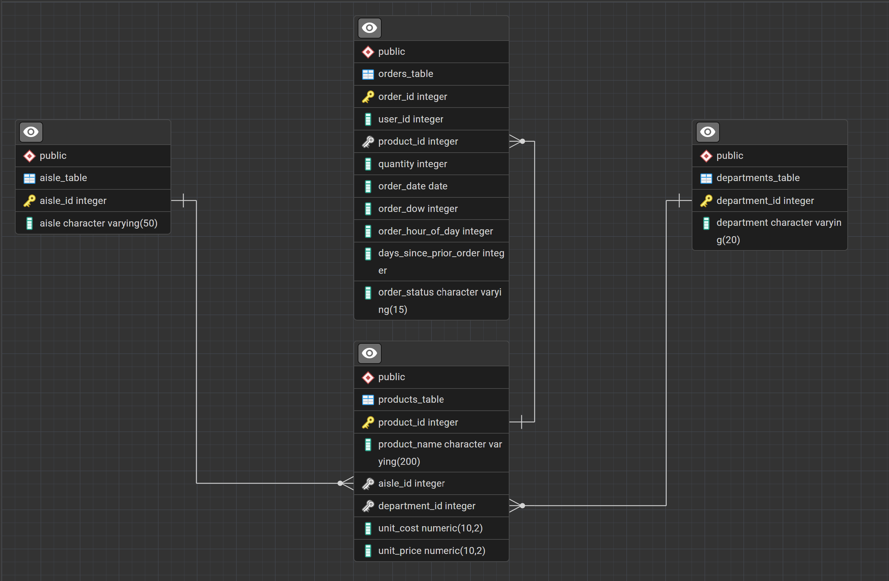

- PostgreSQL: For database creation, querying, and data analysis.
- pgAdmin 4: For database management and executing SQL queries.
- SQL: For data retrieval, transformation, aggregation, and analysis.

## Complete SQL Script

The complete SQL script used for this project is available below. It contains the database table creation statements and all ten analytical queries.  

[View Complete SQL Script](SQL_Scripts/instacart_queries.sql)

## SQL Analysis and key Findinfs

The following section presents the ten business questions investigated in this project. 
Each analysis includes the SQL query used, it's corresponding result, and the key finding obtained 

### 1. Top-Selling Products by Revenue

*Question:* What are the top-selling products by revenue, and how much revenue have they generated?

*SQL Query:*

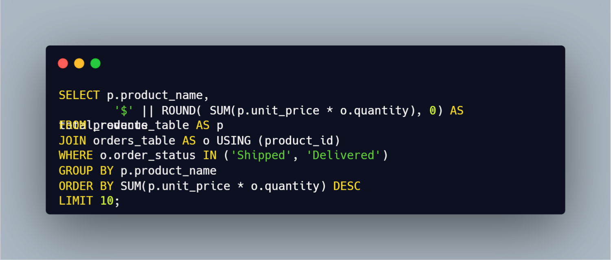

*Query Result:*

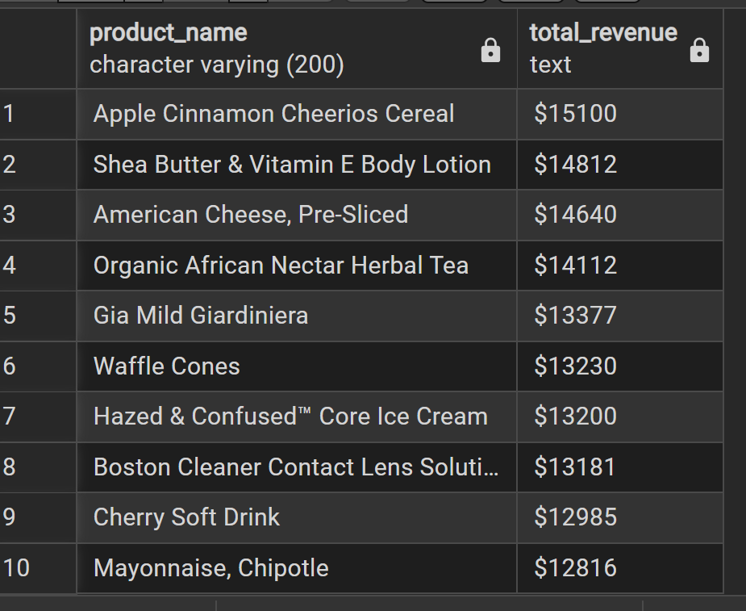

*Key Finding:* Apple Cinnamon Cheerios Cereal recorded the highest revenue among the products analysed,
generating *$15,100*. Revenue among the top 10 products ranged from approximately $12,816 to $15,100.

### 2. Chocolate Sales by Day of the Week

*Question:* On which day of the week are chocolates mostly sold?

*SQL Query:*

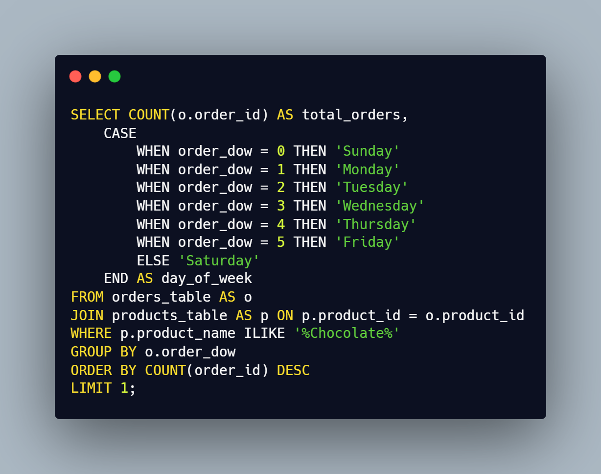

*Query Result:*

*Key Finding:* Sunday recorded the highest number of chocolate orders, with *9,122 orders*.

### 3. Departmental Profitability

*Question:* Are there any departments with revenue exceeding $15 million, and what profit did they generate?

*SQL Query:*

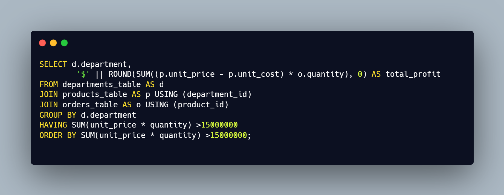

*Query Result:*

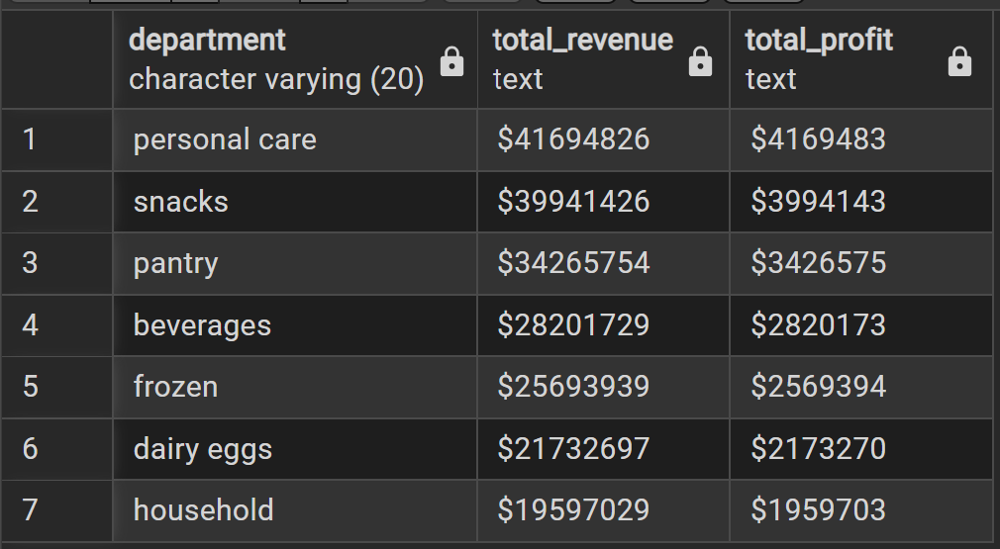

*Key Finding:* Seven departments exceeded the $15 million revenue threshold.
Personal Care recorded the highest profit at *$4,169,483, while Household recorded the lowest profit among the qualifying departments at *$1,959,703**.

### 4. Alcohol Sales on Christmas Day 2019

*Question:* Which product departments recorded the highest sales quantities on Christmas Day 2019, and where did alcoholic products rank?

*SQL Query:*

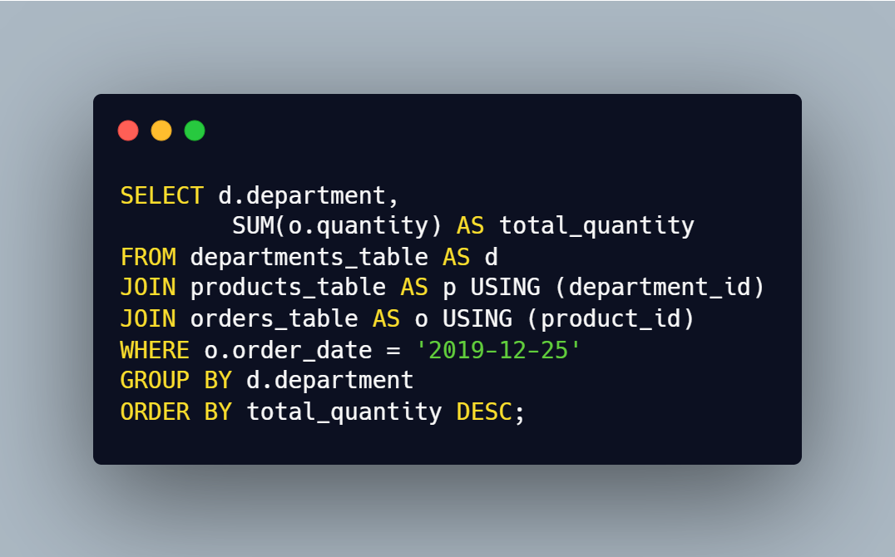

*Query Result:*

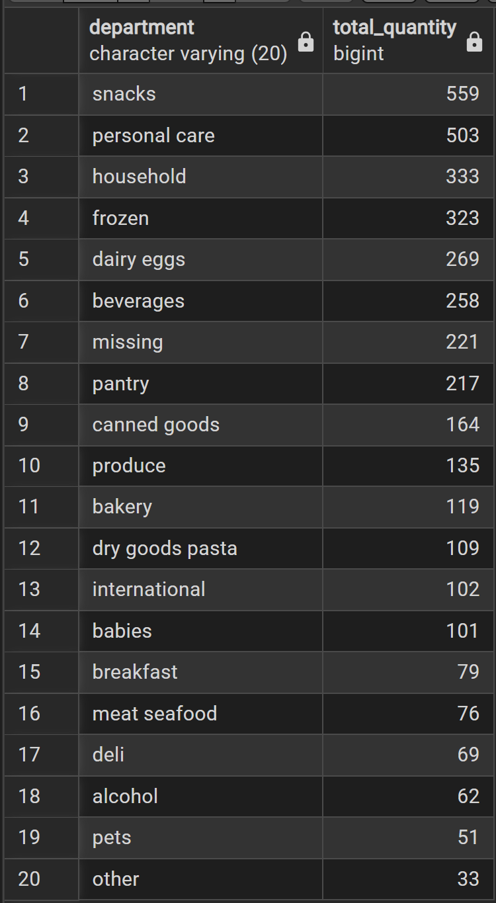

*Key Finding:* Alcoholic products appeared near the bottom of the departmental sales-quantity ranking for Christmas Day 2019.

### 5. Most Profitable Year

*Question:* Which year did Instacart generate the most profit?

*SQL Query:*

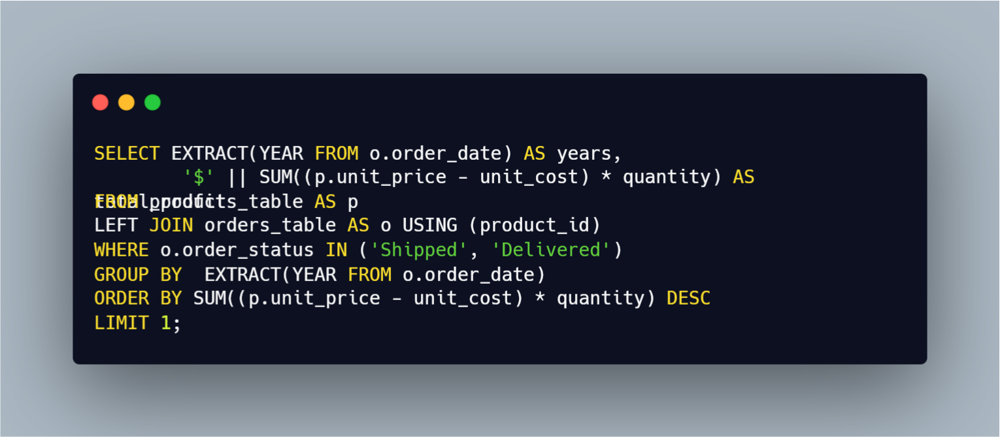

*Query Result:*

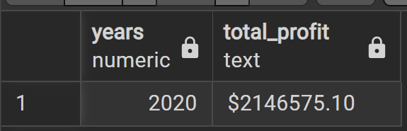

*Key Finding:* 2020 was the most profitable year in the dataset, recording a total profit of *$2,146,575.10*.

### 6. Most Recent Cheese Order

*Question:* How many days had passed since the last cheese order, as of the latest order date in the dataset?

*SQL Query:*

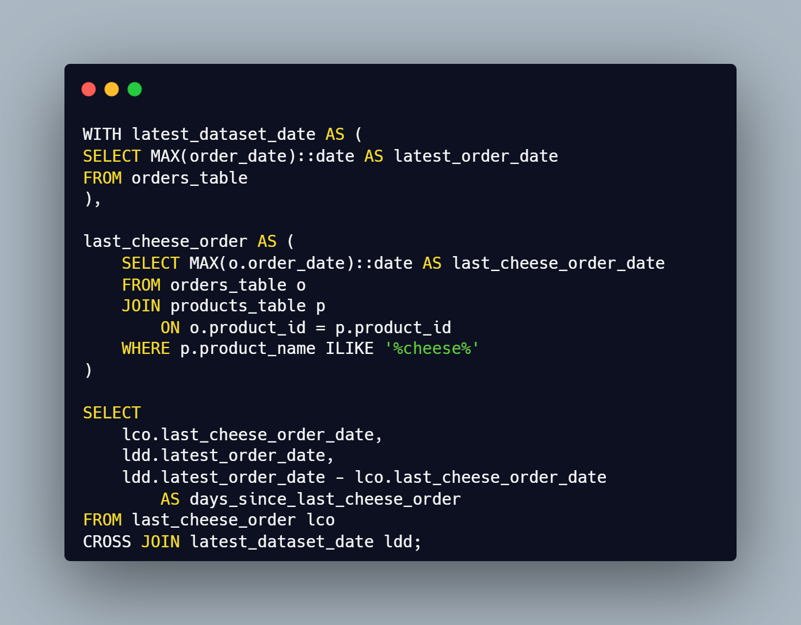

*Query Result:*

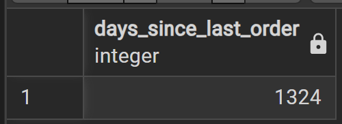

*Key Finding:* The most recent cheese order was recorded on *7 April 2023*, which was also the latest order date in the dataset.
